<picture><source media="(prefers-color-scheme: light)" srcset="assets/banner-light.svg" /></picture>

**An Android app that taps you on the shoulder when you're about to buy an unnecessary coffee.**

---

## The idea

Impulse snacks and café stops add up. SnackSave watches your location and, when you're within **100 m of a café**, pops up a nudge: *"Do you really need that coffee? Maybe try a home recipe instead and save that ₹200."*

---

## Features

| | |
|---|---|
| 📍 **Live location** | Uses Google's fused location provider to know where you are |
| ☕ **Café detection** | Checks Google Places for cafés within 100 m |
| 🛑 **Pushback dialog** | A gentle "do you really need it?" prompt, with an option to see an alternative or open café info anyway |
| 🥤 **Home recipes** | Quick swaps such as Vanilla Latte, Cold Coffee and Chocolate Milkshake |
| 📒 **Spending log** | Records café visits and amounts |

Built with Jetpack Compose and Material 3, with navigation between Home, Recipes and Spending Log screens.

---

## Setup

1. Clone the repo and open the `SnackSave/` folder in **Android Studio**.
2. Get a [Google Places API key](https://developers.google.com/maps/documentation/places/web-service/get-api-key).
3. Put it in `CafeDetector.kt`, replacing the `ENTER API KEY HERE` placeholder. Don't commit your real key.
4. Run on a device or emulator with Android 14 (API 34) or newer and grant location permission.

---

## Code map

All source lives in `SnackSave/app/src/main/java/com/example/snacksave/`.

| File | Role |
|---|---|
| `MainActivity.kt` | Location permission, updates and screen hosting |
| `CafeDetector.kt` | Nearby-café lookup via the Places API |
| `PushbackDialog.kt` | The "do you really need that?" dialog |
| `HomeScreen.kt` · `RecipeListScreen.kt` · `SpendingLogScreen.kt` | The main screens |
| `NavigationDestinations.kt` · `Screen.kt` | Navigation routes |

---

> 🚧 **Status:** early prototype. Features are being wired together and the spending log is still in progress.

<picture><source media="(prefers-color-scheme: light)" srcset="assets/footer-light.svg" /></picture>

Made to keep a little more money in your pocket

Part of <a href="https://github.com/aryankhanna1409">Aryan Khanna's portfolio</a>: one loop, five pours, from robots to AI systems.

